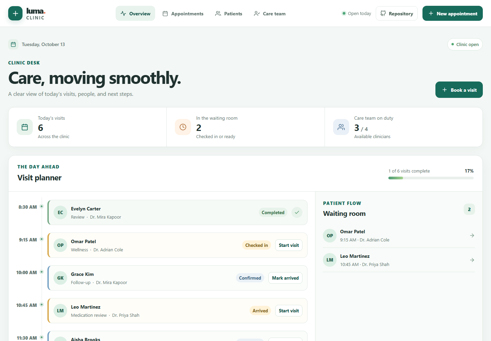

# Clinic Management System

A frontend-only clinic workspace for organizing appointments, patient records, and care team shifts. It uses realistic fictional data to demonstrate everyday clinic operations without connecting to a backend or handling real patient information.

**Live demo:** [https://a2rp.github.io/clinic-management-system/](https://a2rp.github.io/clinic-management-system/)

## Pages

- **Overview** (`/overview`) shows today's visits, waiting room activity, team availability, and visit progress. Use the visit actions to mark patients arrived, move a visit into a room, or complete it.
- **Appointment book** (`/appointments`) lets you move between dates, search visits, filter by status or clinician, update visit status, and open each appointment for its details.
- **Patient directory** (`/patients`) supports patient search and status filters. The selected record shows contact details, care notes, allergies, visit history, and the next scheduled visit. Schedule a visit from a record to preselect that patient.
- **Care team** (`/care-team`) lists clinicians, specialties, rooms, shift times, and today's visit assignments. Search and filter the roster, change duty status, or manage clinician profiles.
- **Not found** shows a clear recovery path when a route is unavailable.

## Included workflows

- Create and edit appointments with a patient, clinician, visit type, date, time, duration, room, and preparation note.
- Create and edit patient records with contact information, status, visit reason, allergies, and care notes.
- Add and edit clinician profiles with specialty, room, regular shift, and work email.
- Move appointment status through confirmed, arrived, checked in, in room, and completed. Dashboard counts and patient visit dates follow the same session state.
- Search appointments, patients, and clinicians. Filter appointments by date, status, or clinician, and patient records by active status.
- Review appointment details and visit preparation before changing or removing a visit.
- Use custom dialogs for forms and destructive confirmations, with validation, keyboard support, and toast feedback.
- Use the repository link in the header and the creator and source links in the footer.

## Demo data and limits

The records are fictional examples kept in React state while the page is open. Changes are shared across routes during the current session and reset when the page is refreshed. No browser storage, API, account system, external calendar, or electronic health record is connected. Do not enter real patient information.

This project demonstrates clinic scheduling and records management in the browser. It does not provide medical advice, clinical decision support, billing, or secure patient data storage.

## Local setup

From this project folder, install dependencies and start Vite:

```powershell
npm.cmd install
npm.cmd run dev
```

Use the local URL printed by Vite. The app is configured under `/clinic-management-system/` for its GitHub Pages deployment.

## Checks and deployment

```powershell
npm.cmd run lint
npm.cmd run build
npm.cmd run deploy
```

The deploy script builds the app, adds the GitHub Pages single-page route fallback, and publishes `dist` to the `gh-pages` branch. The public site is [https://a2rp.github.io/clinic-management-system/](https://a2rp.github.io/clinic-management-system/).

## Screenshots

These screenshots show the finished app at a 1440 by 1000 viewport. The route gallery includes every user-facing page; the dialog gallery includes create and edit forms, appointment details, and removal confirmations.

### Pages

**Clinic overview**


**Appointment book**

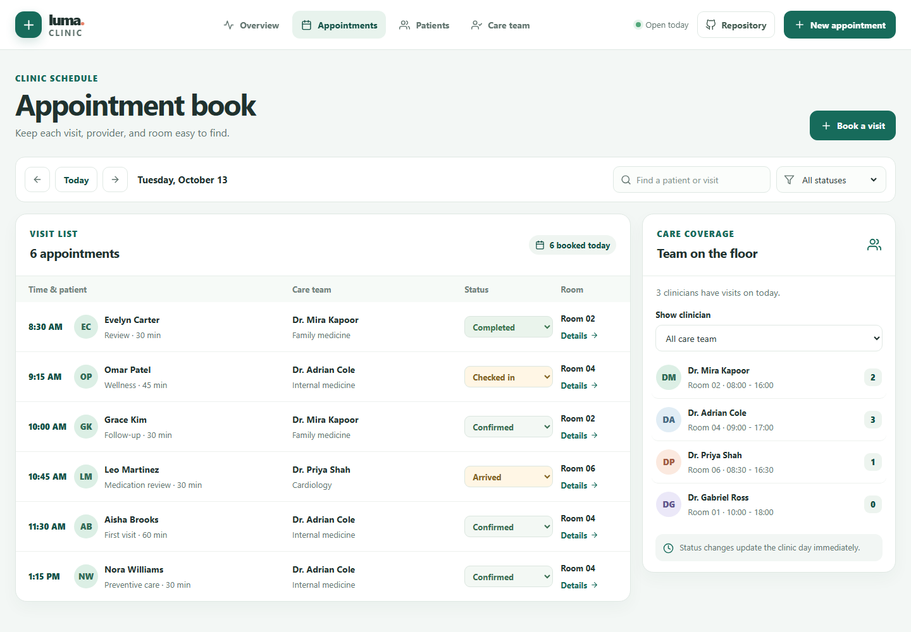

**Patient directory**

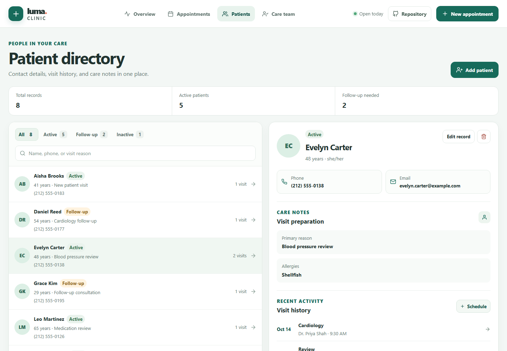

**Care team roster**

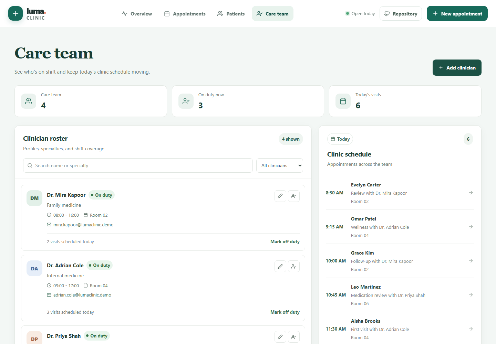

**Not found page**

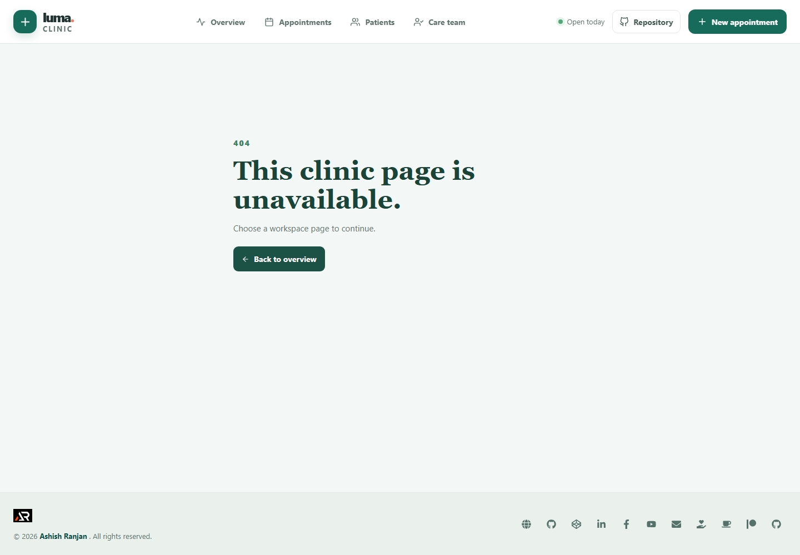

### Forms and details

**Create appointment**

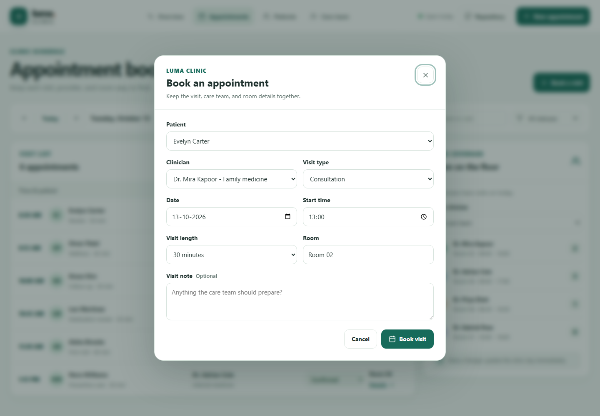

**Edit appointment**

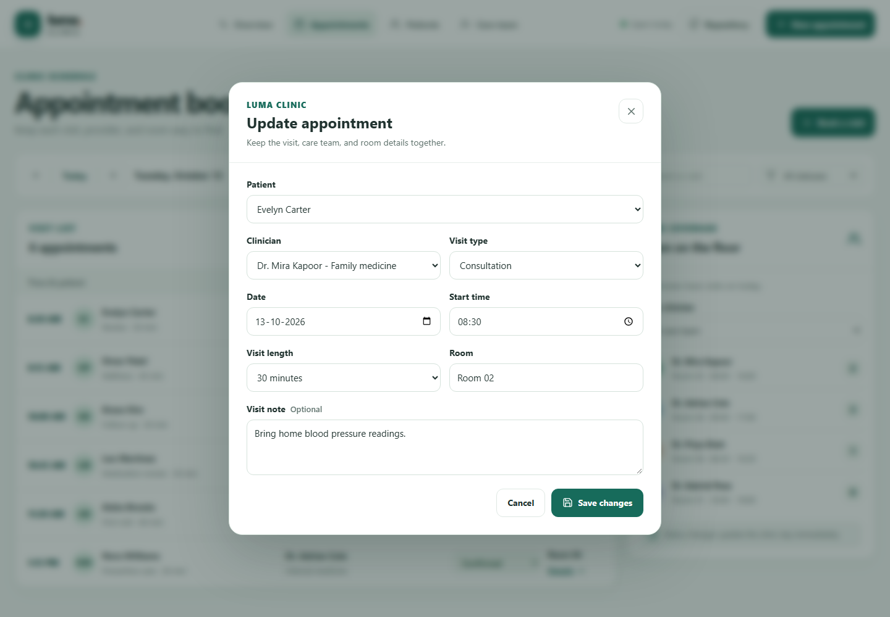

**Appointment details**

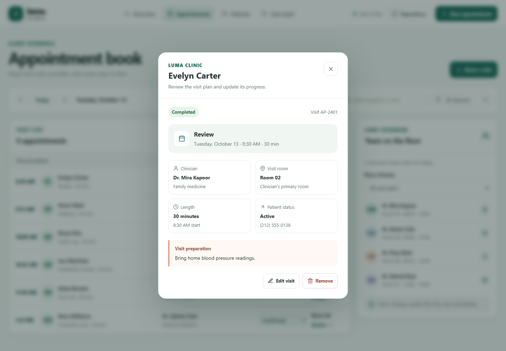

**Create patient**

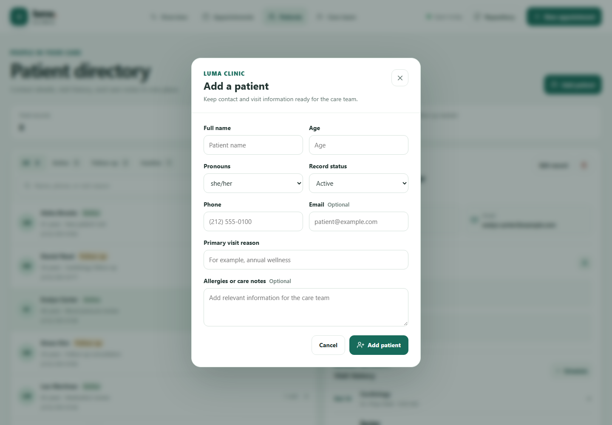

**Edit patient**

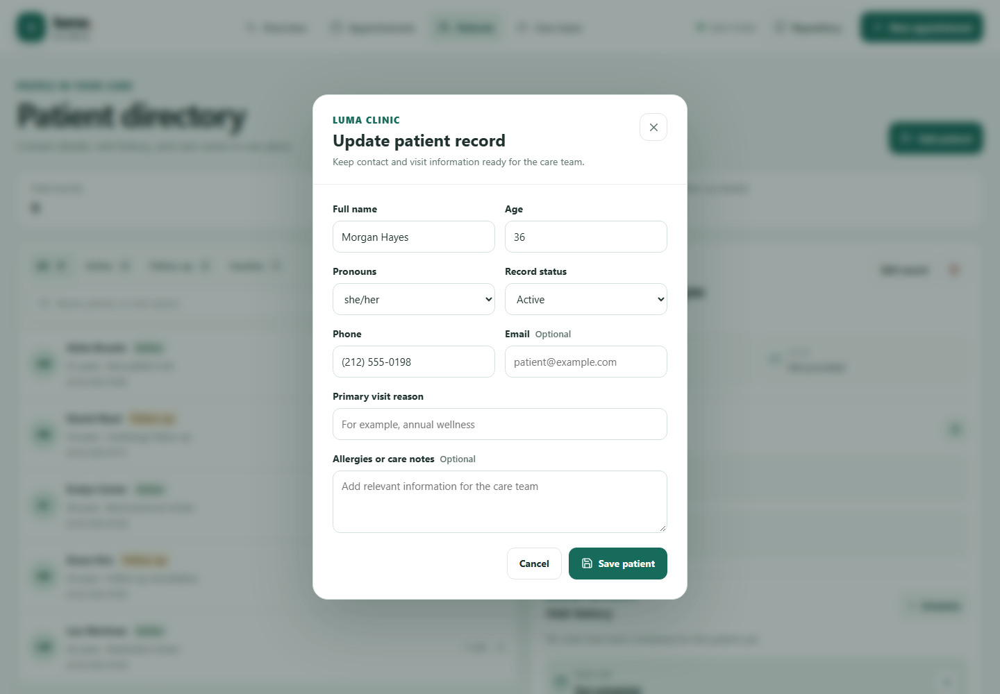

**Create clinician**

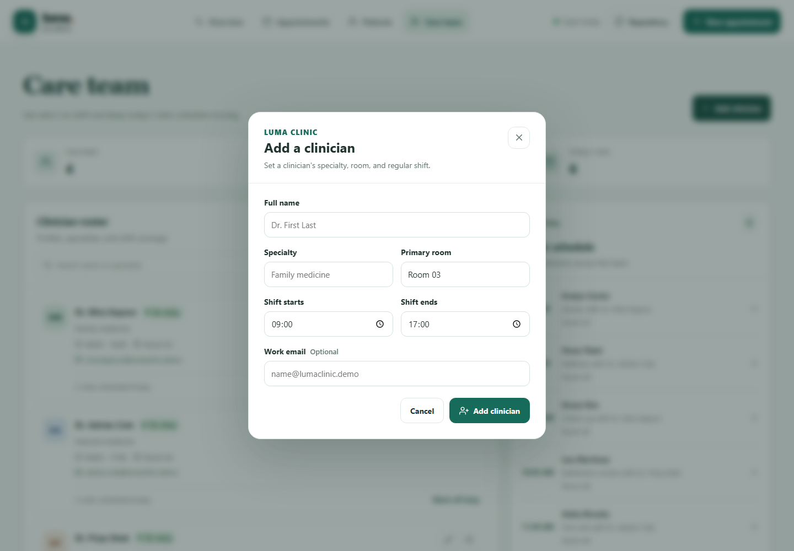

**Edit clinician**

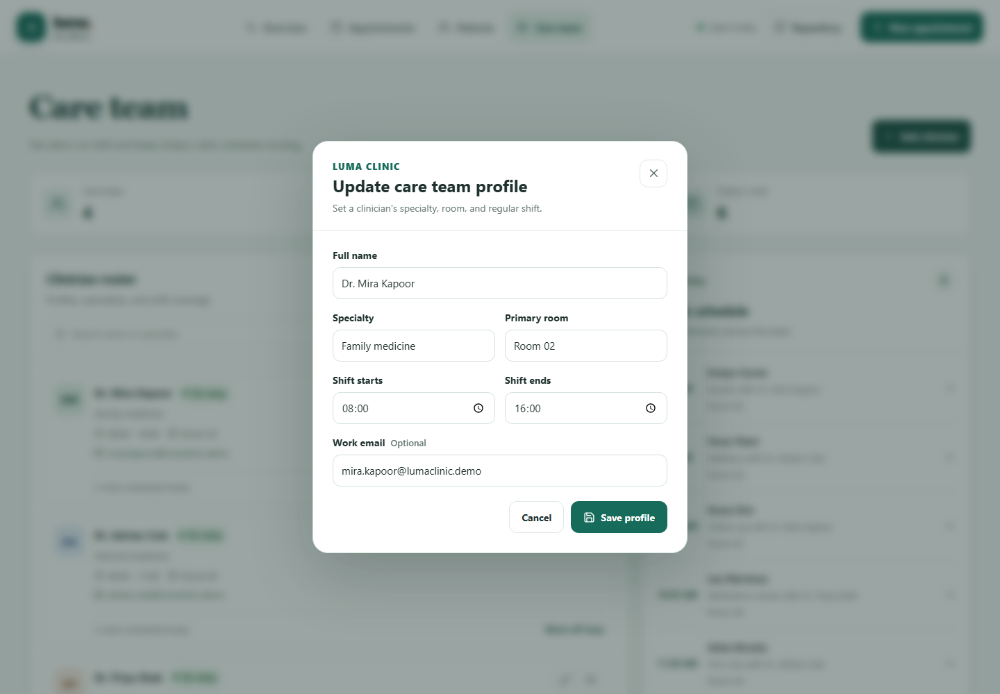

### Removal confirmations

**Remove appointment confirmation**

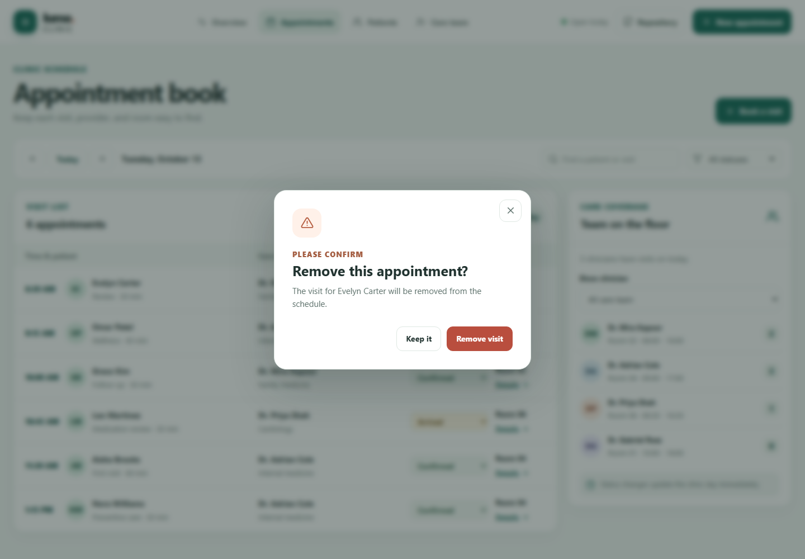

**Remove patient confirmation**

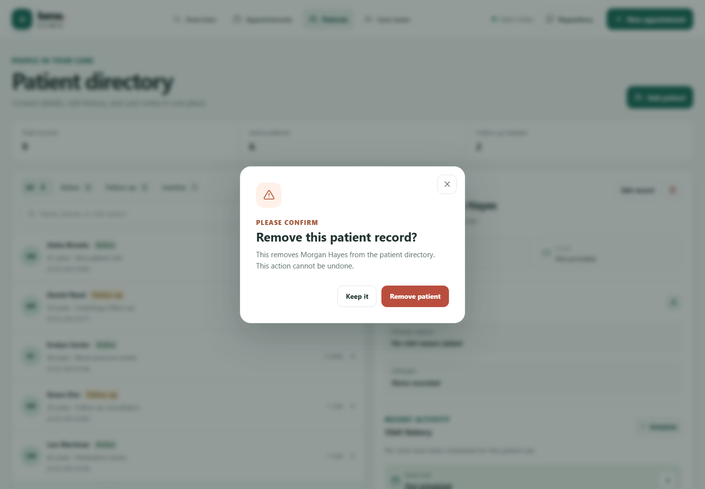

**Remove clinician confirmation**

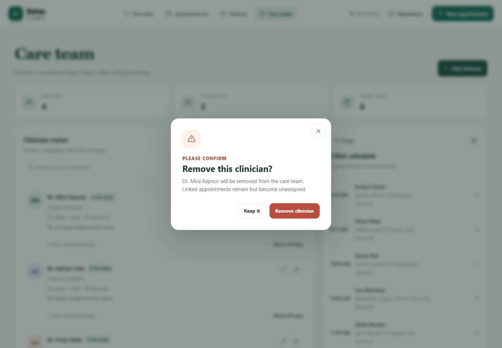

## Future improvements

These are extensions beyond the current frontend demo:

- Connect to a secure backend for shared clinic data, user accounts, and role-based access.
- Integrate with an electronic health record system after privacy, security, and compliance requirements are defined.
- Add calendar synchronization and server-managed appointment reminders.
- Add a server-side audit history for record changes and appointment decisions.
- Support securely hosted patient documents with appropriate access controls.

## Links

- Portfolio: [https://www.ashishranjan.net](https://www.ashishranjan.net)
- GitHub: [https://github.com/a2rp](https://github.com/a2rp)
- CodePen: [https://codepen.io/ash1198](https://codepen.io/ash1198)
- LinkedIn: [https://www.linkedin.com/in/aashishranjan](https://www.linkedin.com/in/aashishranjan)
- Facebook: [https://www.facebook.com/theash.ashish/](https://www.facebook.com/theash.ashish/)
- YouTube: [https://www.youtube.com/@ashishranjan-ashz?sub_confirmation=1](https://www.youtube.com/@ashishranjan-ashz?sub_confirmation=1)
- Email: [mailto:ash.ranjan09@gmail.com](mailto:ash.ranjan09@gmail.com)

## Support

- Support: [https://a2rp-donation-page.netlify.app/](https://a2rp-donation-page.netlify.app/)
- Buy Me a Coffee: [https://buymeacoffee.com/ashishranjan](https://buymeacoffee.com/ashishranjan)
- Patreon: [https://www.patreon.com/ashishranjan](https://www.patreon.com/ashishranjan)
